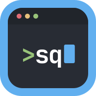

<div align="center">



# msquintana.com

**Portafolio personal de Steven Quintana: ciberseguridad, infraestructura y cloud.**

[Ver el sitio](https://msquintana.com) · [Blog](https://msquintana.com/es/blog/) · [LinkedIn](https://www.linkedin.com/in/msquintana)

</div>

Sitio estático de una sola página, con un blog de artículos y write-ups técnicos. Usa la paleta **One Dark Pro** y una
estética de terminal. Está en **inglés** (`/`) y **español** (`/es/`), y el botón EN / ES cambia de idioma en cualquier
página.

## Qué tiene

| Parte | Qué hace |
| --- | --- |
| **Inicio** | Animación que escribe `whoami` y luego muestra el nombre, el enfoque y la frase principal. |
| **Terminal interactiva** | Comandos `help`, `whoami`, `about`, `skills`, `projects`, `certs`, `contact`, `lang` y `clear`, con alias en español, historial (↑ ↓) y autocompletado con Tab. |
| **Secciones** | Sobre mí, habilidades, proyectos con enlaces, certificaciones y metas, y contacto. |
| **Blog** | Artículos en Markdown, filtro por etiquetas, tiempo de lectura, código resaltado con Shiki (`one-dark-pro`) y feed RSS. |
| **SEO** | `<title>`, descripción, `canonical`, `hreflang` y Open Graph en todas las páginas. Las imágenes de vista previa (PNG de 1200×630) se generan en el build. |
| **Movimiento** | Las secciones aparecen al hacer scroll, los títulos se escriben solos, el menú marca la sección actual y hay una barra de progreso. Si el sistema pide reducir el movimiento, no hay animaciones; sin JavaScript se ve todo el contenido. |

## Tecnologías

| Uso | Herramienta |
| --- | --- |
| Sitio | [Astro](https://astro.build) 7, HTML estático sin frameworks de interfaz |
| Contenido | Colecciones de contenido de Astro, validadas con Zod |
| Idiomas | Rutas i18n de Astro (`en` por defecto, `es` en `/es/`) |
| Código en el blog | Shiki con el tema `one-dark-pro` |
| Feed | `@astrojs/rss` |
| Imágenes Open Graph | `satori` + `@resvg/resvg-js`, con las fuentes de `@fontsource` |
| Tipografía | JetBrains Mono (títulos, código) e Inter (texto) |
| Hosting | Cloudflare Pages |

## Verlo en tu computadora

Requiere Node.js 22.23 o más reciente.

```bash
npm install
npm run dev       # http://localhost:4321
```

| Comando | Qué hace |
| --- | --- |
| `npm run dev` | Servidor de desarrollo; se recarga al guardar. Muestra también los borradores del blog. |
| `npm run build` | Genera el sitio publicable en `dist/`, sin borradores. |
| `npm run preview` | Sirve `dist/` para revisarlo como quedará publicado. |

## Cómo editar el contenido

| Quiero cambiar… | Archivo |
| --- | --- |
| Textos de la interfaz, habilidades y certificaciones (en los dos idiomas) | [`src/i18n/ui.ts`](src/i18n/ui.ts) |
| Correo, GitHub y LinkedIn | [`src/config.ts`](src/config.ts) |
| Proyectos | `src/content/projects/en/*.md` y `src/content/projects/es/*.md` |
| Artículos del blog | `src/content/blog/*.md` |
| Colores, tipografía y espaciado | [`src/styles/global.css`](src/styles/global.css) |
| Estilos de lectura de los artículos | [`src/styles/prose.css`](src/styles/prose.css) |
| Diseño de las imágenes de vista previa | [`src/lib/og.ts`](src/lib/og.ts) |

### Proyectos

Cada proyecto tiene un archivo por idioma, con el mismo nombre en `en/` y en `es/`:

```md
---
title: Hypr-Dotfiles
problem: Qué problema resuelve.
result: Qué se logró.
tools: [Arch Linux, Hyprland, Bash, Git]
order: 3                     # posición en la lista
repo: https://github.com/…   # opcional: botón "Código fuente"
demo: https://…              # opcional: botón "Ver sitio"
draft: true                  # opcional: lo oculta hasta que esté listo
---
```

### Artículos del blog

El nombre del archivo es la URL: `src/content/blog/dns-cloudflare-router-claro.md` se publica en
`/blog/dns-cloudflare-router-claro/` y `/es/blog/dns-cloudflare-router-claro/`.

```md
---
title: Cómo cambiar los DNS de un router Claro a Cloudflare
description: Resumen corto; se usa en la lista, en Google y en LinkedIn.
date: 2026-10-26
updated: 2026-11-02          # opcional
tags: ["redes", "dns"]
lang: es                     # es (por defecto) o en
draft: true                  # los borradores solo se ven con npm run dev
---

## Primera sección
```

Para publicar un artículo, cambia `draft: true` a `draft: false`. Con eso aparece en el blog, en el feed RSS y en las
páginas de sus etiquetas, y se genera su imagen de vista previa.

> En los artículos de seguridad no publiques IPs reales, nombres de redes, credenciales ni datos de terceros.

## Estructura

```
public/                 favicon y logos
src/
├── components/         secciones de la página principal (Hero, Projects, Nav…)
│   └── blog/           lista, tarjetas y página de artículo
├── content/
│   ├── blog/           artículos en Markdown
│   └── projects/       proyectos en Markdown (en/ y es/)
├── i18n/ui.ts          todos los textos en inglés y español
├── layouts/Base.astro  <head>, SEO y Open Graph
├── lib/                consultas del blog y proyectos, imágenes Open Graph
├── pages/              rutas: /, /es/, /blog, /es/blog, /rss.xml, /og/*.png
├── scripts/            animaciones y terminal interactiva
└── styles/             estilos globales y de lectura
```

## Publicación

El sitio se publica en **Cloudflare Pages** desde este repositorio. Cada push a `main` lo vuelve a construir solo.

| Ajuste | Valor |
| --- | --- |
| Framework preset | Astro |
| Comando de build | `npm run build` |
| Carpeta de salida | `dist` |
| Variable de entorno | `NODE_VERSION` = `22.23.4` o más reciente |

El dominio `msquintana.com` se agrega en **Custom domains** del proyecto. El correo del dominio usa registros MX y TXT
aparte, que no hay que tocar.

---

Hecho por [Steven Quintana](https://msquintana.com) · Diseño basado en la paleta One Dark Pro.
