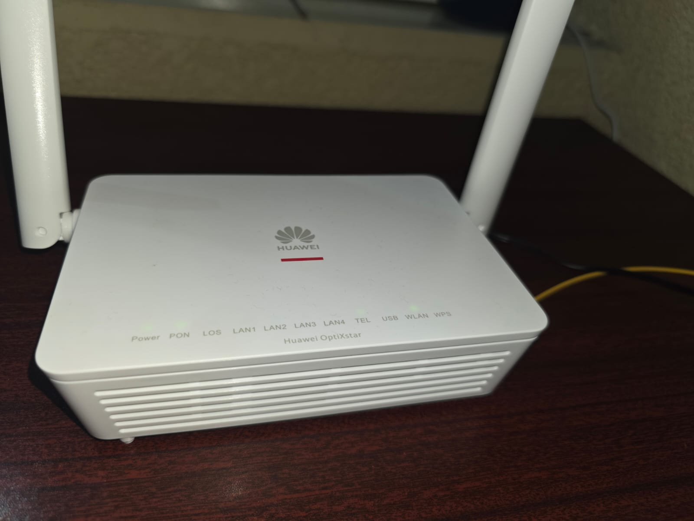
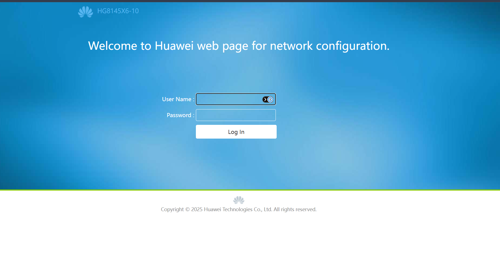
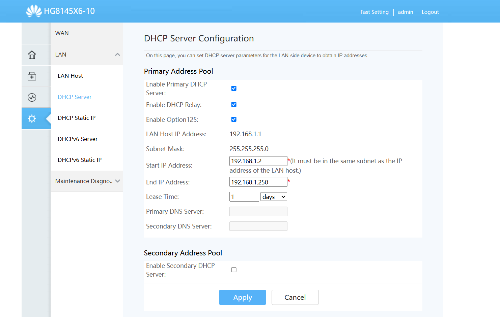
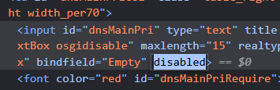
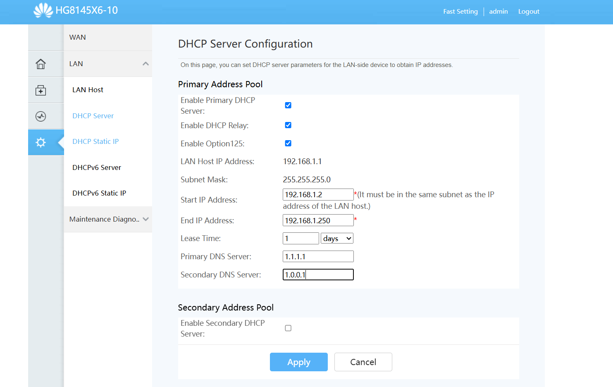
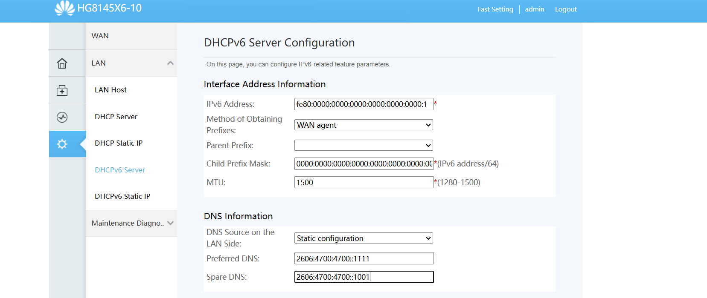
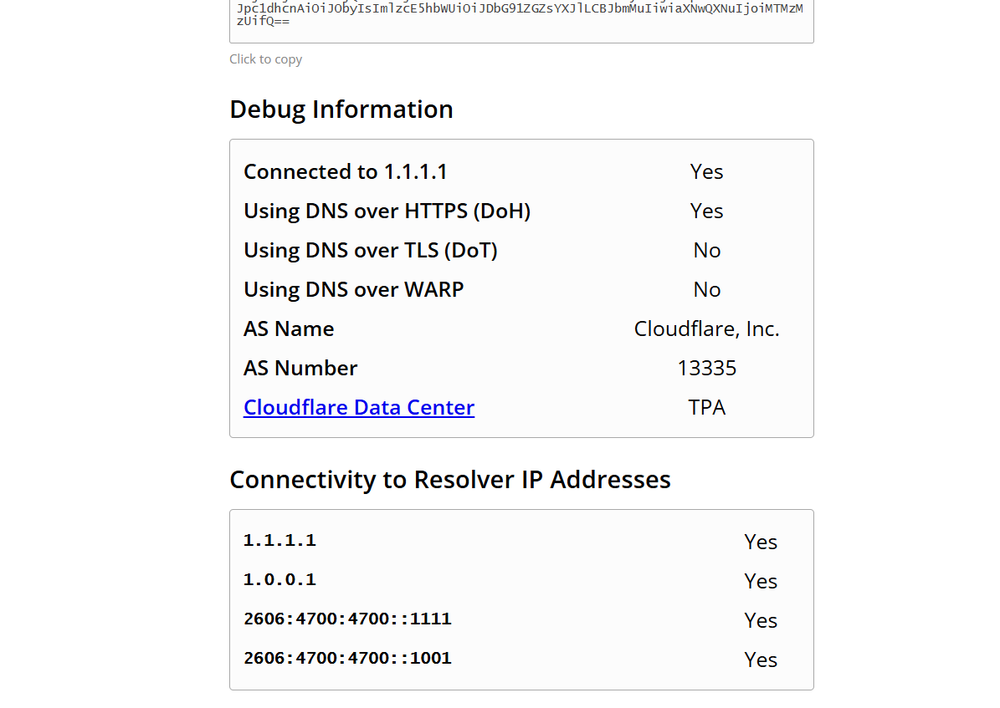
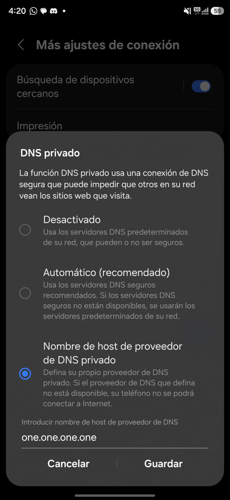

Si tienes internet por fibra óptica en Guatemala, es muy probable que tu proveedor te haya instalado un **módem Huawei** como este. Hace poco quise cambiar los DNS del mío y me encontré con que la opción estaba bloqueada. Después de investigar, encontré cómo hacerlo, y en esta guía te explico paso a paso cómo lograrlo, aunque no tengas experiencia en redes.

Módem de fibra Huawei

---

## Primero: ¿qué es un DNS?

Cuando escribes `google.com` en el navegador, tu computadora no sabe dónde está ese sitio. Necesita preguntarle a un **servidor DNS**, que funciona como una **agenda de contactos de internet**: tú le das el nombre del sitio y él te devuelve su "número" (la dirección IP).

Por defecto, todos los dispositivos de tu casa usan el DNS de tu proveedor de internet (Tigo, Claro u otro). Pero puedes cambiarlo por otro.

> **¿Me va a dar más velocidad de descarga o menos lag en juegos?** No. El DNS solo ayuda a _encontrar_ los sitios; no cambia tu velocidad de internet ni tu ping dentro de un juego.

---

## ¿Por qué Cloudflare y no el DNS de tu proveedor?

**Cloudflare** es una de las empresas de infraestructura de internet más grandes del mundo, y ofrece su DNS público **gratis**. Estas son las razones por las que lo prefiero sobre el DNS de Tigo, Claro o cualquier proveedor local:

||DNS de tu proveedor|DNS de Cloudflare|
|---|---|---|
|**Confiabilidad**|Si su DNS falla, te quedas "sin internet" aunque tu conexión funcione|Red global con cientos de centros de datos; muy difícil que falle|
|**Privacidad**|Tu proveedor ve y puede registrar todos los sitios que consultas|Política pública de no vender tus datos y borrar los registros en 24 horas, con auditorías externas|
|**Manipulación**|Algunos proveedores redirigen páginas inexistentes a publicidad o bloquean sitios desde su DNS|Responde lo que es, sin redirecciones ni publicidad|
|**Protección opcional**|Normalmente no ofrece filtros|Puedes elegir bloquear sitios peligrosos o contenido para adultos (ver abajo)|
|**Cifrado**|Normalmente sin cifrar|Soporta DNS cifrado (útil en el celular)|
|**Velocidad**|Puede ser rápido porque está dentro de la red del proveedor|Muy rápido; uno de los DNS públicos con mejor tiempo de respuesta|

---

## Elige tu tipo de DNS de Cloudflare

Cloudflare tiene **tres versiones** de su DNS. Todas son gratuitas; la diferencia es **qué bloquean**:

- **1.1.1.1 – Sin filtrado:** responde todo, sin bloquear nada. Ideal si solo quieres un DNS rápido y privado.
- **1.1.1.2 – Bloquea malware:** igual que el anterior, pero **no te deja entrar a sitios conocidos de virus, estafas y páginas falsas (phishing)**. Es una capa extra de seguridad para toda la casa.
- **1.1.1.3 – Bloquea malware y contenido para adultos:** además de lo anterior, **bloquea páginas para adultos**. Útil si en casa hay niños.

Usa **los cuatro valores de la misma fila** en tu módem:

|Tipo|IPv4 primario|IPv4 secundario|IPv6 primario|IPv6 secundario|
|---|---|---|---|---|
|**Sin filtrado**|`1.1.1.1`|`1.0.0.1`|`2606:4700:4700::1111`|`2606:4700:4700::1001`|
|**Bloquea malware**|`1.1.1.2`|`1.0.0.2`|`2606:4700:4700::1112`|`2606:4700:4700::1002`|
|**Bloquea malware y adultos**|`1.1.1.3`|`1.0.0.3`|`2606:4700:4700::1113`|`2606:4700:4700::1003`|

> 💡 **No mezcles filas.** Si pones el primario de una y el secundario de otra, tus dispositivos a veces usarán uno y a veces el otro, y el filtrado funcionará solo "a ratos".

> En esta guía uso los de **sin filtrado** como ejemplo. Si elegiste otra versión, solo cambia los números por los de tu fila.

---

## Lo que vas a necesitar

- Una **computadora** conectada a tu WiFi o por cable al módem.
- El **usuario y contraseña** del módem (vienen en la etiqueta que tiene debajo).
- 15 minutos.

> ⚠️ **Antes de empezar:** cambia solo lo que se indica en esta guía. Si modificas otras opciones podrías quedarte sin internet. Y **no presiones el botón de Reset** del módem: borra toda la configuración que dejó tu proveedor.

---

## Paso 1: Entrar al panel del módem

1. Abre tu navegador (Chrome, Edge, Firefox).
2. En la barra de direcciones escribe: `192.168.1.1` y presiona Enter.
3. Ingresa el **usuario y contraseña** de la etiqueta del módem.

> ⚠️ Si en la etiqueta no encuentras las credenciales, puedes buscarlas en internet para tu modelo en específico.

Pantalla de inicio de sesión

> Si el navegador dice "No es seguro", es normal: es la página interna de tu módem.

---

## Paso 2: Ir a la configuración de DNS

1. Entra a **Advanced Configuration** (Configuración avanzada).
2. En el menú de la izquierda, abre **LAN**.
3. Haz clic en **DHCP Server**.

Vas a ver los campos **Primary DNS Server** y **Secondary DNS Server**. Lo más probable es que aparezcan **en gris** y no te dejen escribir. 😤

Campos de DNS bloqueados

Tu proveedor bloquea esa opción en la cuenta de usuario normal. Pero ese bloqueo **solo está en la página**, así que podemos quitarlo.

---

## Paso 3: Desbloquear los campos

1. Haz **clic derecho** sobre el campo **Primary DNS Server** y elige **Inspeccionar**.
2. Se abrirá un panel con código. La línea del campo quedará resaltada y verás algo como `disabled` o `disabled="disabled"`.
3. Haz **doble clic** sobre la palabra `disabled`, bórrala y presiona Enter.
4. Haz lo mismo con el campo **Secondary DNS Server**.

Quitar la palabra disabled en Inspeccionar

¡Listo! Ahora los campos ya te dejan escribir.

> **¿Esto es seguro?** Sí. Solo estás cambiando cómo se ve la página en _tu_ navegador; no estás modificando el módem por dentro. Si cierras la página sin guardar, todo queda igual.

---

## Paso 4: Escribir los DNS de IPv4

En los campos que acabas de desbloquear escribe los valores **IPv4** de la versión que elegiste. Por ejemplo, sin filtrado:

|Campo|Valor|
|---|---|
|**Primary DNS Server**|`1.1.1.1`|
|**Secondary DNS Server**|`1.0.0.1`|

Luego haz clic en **Apply**.

DNS configurados

Recarga la página: si los números siguen ahí, **el cambio se guardó**. 🎉

> **¿Por qué dos direcciones?** Son dos "puertas" distintas al mismo servicio de Cloudflare. Si una no responde, tus dispositivos usan la otra.

---

## Paso 5: No te olvides de IPv6 (el paso que casi todos se saltan)

Muchos módems de fibra ya usan **IPv6**, la versión nueva de las direcciones de internet. Funciona en paralelo con la versión de siempre (IPv4), y **tiene sus propios DNS**. Si solo cambias los del paso anterior, una parte de tu navegación seguirá usando el DNS de tu proveedor.

1. En el mismo menú **LAN**, entra a **DHCPv6 Server**.
2. Busca la opción **DNS Source on the LAN Side**. Seguramente dice **DNS agent**.
3. Cámbiala a la opción **Static** (o "estático").
4. Aparecerán campos para los DNS. Escribe los valores **IPv6** de tu versión. Por ejemplo, sin filtrado:

|Campo|Valor|
|---|---|
|**DNS primario**|`2606:4700:4700::1111`|
|**DNS secundario**|`2606:4700:4700::1001`|

5. Haz clic en **Apply**.

Configurar DNS de IPv6

> Si esa opción también está en gris, usa el mismo truco de **Inspeccionar** del Paso 3.

> ⚠️ En esta pantalla **solo cambia la parte de DNS**. Las demás opciones son las que hacen funcionar IPv6.

---

## Paso 6: Comprobar que funciona

1. **Desconecta y vuelve a conectar** el WiFi en tu computadora o celular, para que tome los nuevos DNS.
2. Entra a 👉 **[1.1.1.1/help](https://1.1.1.1/help)**
3. Si dice **"Connected to 1.1.1.1: Yes"**, todo quedó bien.

Comprobación en 1.1.1.1/help

Desde ahora, **todos los dispositivos de tu casa** usan los nuevos DNS automáticamente, sin configurar nada en cada uno.

> Si tu proveedor actualiza o reinicia el módem de forma remota, la configuración podría regresar a como estaba. Si notas que pasó, solo repite esta guía.

---

## Extra: protege tu celular también fuera de casa

Lo que configuraste en el módem solo funciona en tu casa. Si usas WiFi públicos (cafés, hoteles, universidad) o datos móviles, puedes activar el **DNS privado** en tu celular Android:

1. **Ajustes → Conexiones → Más opciones de conexión → DNS privado.**
2. Elige **Nombre de host del proveedor de DNS privado**.
3. Escribe el nombre según la versión que quieras y guarda:

|Tipo|Nombre de host|
|---|---|
|**Sin filtrado**|`one.one.one.one`|
|**Bloquea malware**|`security.cloudflare-dns.com`|
|**Bloquea malware y adultos**|`family.cloudflare-dns.com`|

